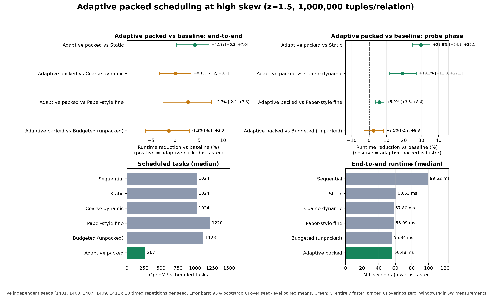

# High-skew adaptive scheduling result



## Experiment

This report is generated from `results/adaptive_gate_reproduction.csv`. It includes only rows with `correct=true` and compares fully paired policies on identical inputs. The selected high-skew condition is Zipf z=1.5, with 1,000,000 tuples in each relation, 4 OpenMP threads, seeds 1401, 1403, 1407, 1409, 1411, and 10 timed repetitions per seed. There are 300 measurements in this high-skew slice. The CSV configuration is q=32, coarse batch=8, and packing threshold=16.

The 95% intervals bootstrap independent seed clusters: timed paired improvements are averaged within each seed, then seeds are resampled. They are not bootstraps over individual repetitions.

## Paired performance

Positive values indicate that `novelty_packed` is faster. End-to-end includes radix partitioning, build, and probe; probe-phase time isolates the probe stage.

| Baseline | End-to-end reduction (95% seed-bootstrap CI) | Probe reduction (95% seed-bootstrap CI) |
|---|---:|---:|
| Static | +4.09% [+0.28%, +7.01%] | +29.85% [+24.89%, +35.12%] |
| Coarse dynamic | +0.15% [-3.22%, +3.33%] | +19.12% [+11.81%, +27.15%] |
| Paper-style fine | +2.73% [-2.44%, +7.60%] | +5.86% [+3.57%, +8.59%] |
| Budgeted (unpacked) | -1.26% [-6.12%, +2.97%] | +2.51% [-2.90%, +8.32%] |

At this high-skew setting, the policy reduced median end-to-end time to 56.48 ms. Median task count was 267 versus 1024 for static scheduling (73.9% fewer), 1220 for paper-style fine scheduling (78.1% fewer), and 1123 for the unbundled budgeted policy (76.2% fewer). The adaptive policy used 128 fine chunks of a configured budget of 128; median max/average partition imbalance was 392.24.

## Interpretation and limits

This is evidence of a high-skew benefit on this specific measured machine and workload, not proof of general superiority. An interval crossing zero means this experiment did not resolve an end-to-end difference from that baseline. The adaptive threshold was selected after exploratory runs, the five-seed interval is preliminary, Windows/MinGW is not the target Linux environment, and the `paper_fine` policy is an approximation rather than an exact historical reproduction.

The figure is generated directly from the measured CSV; it does not contain hand-entered runtime or task-count values. Recreate it with:

```powershell
.\.venv\Scripts\python.exe scripts\make_final_visual.py --input results\adaptive_gate_reproduction.csv --output-dir results\adaptive_gate_reproduction_analysis
```
