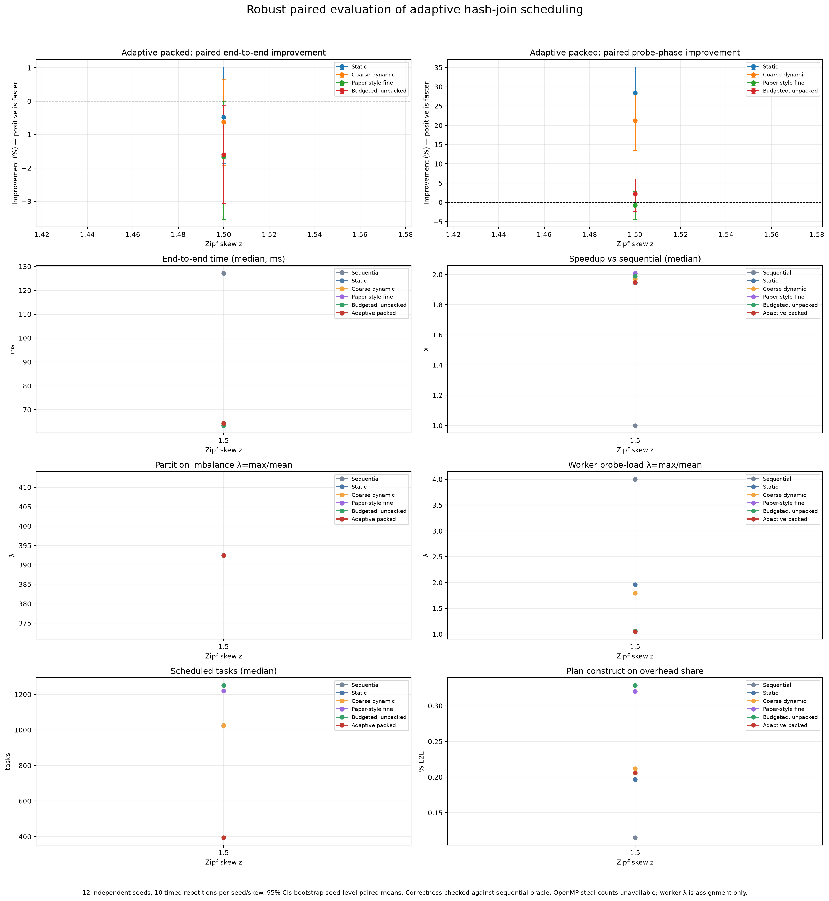
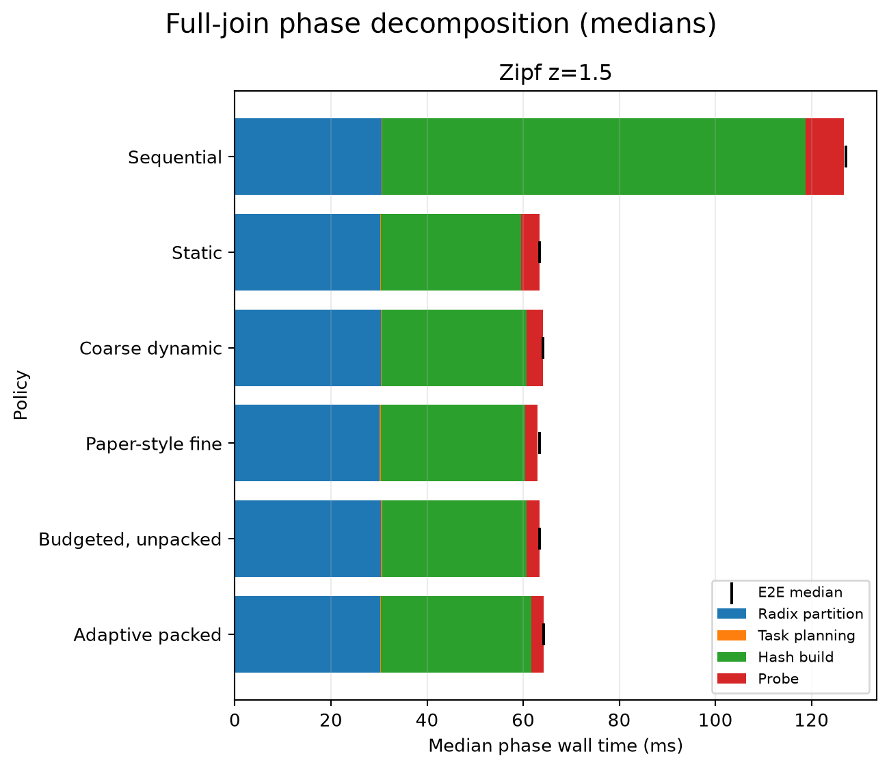

# Robust adaptive hash-join evaluation

## Design and validation

Raw measurements: `results/robust_q64_confirmation.csv`. This evaluation uses 12 independent seeds (4103, 4111, 4127, 4129, 4133, 4139, 4153, 4157, 4159, 4177, 4201, 4211), 10 timed repetitions per seed/skew, 720 rows, [4] thread(s), q=[64], coarse batch=[8], and pack threshold=[16.0]; every policy uses identical generated inputs. All 720 rows passed the executable's independent sequential-oracle cardinality check. Worker task totals equal planned tasks on every row.

The 95% intervals resample independent seed clusters: policy-paired timed percent improvements are averaged within each seed, then seeds are bootstrap-resampled. Repetitions are not treated as independent samples. Positive improvement means `novelty_packed` is faster.

## High-skew end-to-end comparison (z=1.5)

| Baseline | Adaptive packed improvement, 95% seed-bootstrap CI |
|---|---:|
| Static | -0.48% [-1.86%, +1.02%] |
| Coarse dynamic | -0.62% [-1.91%, +0.64%] |
| Paper-style fine | -1.67% [-3.54%, -0.01%] |
| Budgeted, unpacked | -1.60% [-3.06%, -0.14%] |

## Full-join phase metrics at z=1.5

Median time by stage; E2E is measured separately and appears as a black tick in the plot.

| Policy | Partition (ms) | Planning (ms) | Build (ms) | Probe (ms) | End-to-end (ms) |
|---|---:|---:|---:|---:|---:|
| Sequential | 30.56 | 0.148 | 88.11 | 7.88 | 127.18 |
| Static | 30.19 | 0.132 | 29.29 | 3.84 | 63.41 |
| Coarse dynamic | 30.36 | 0.138 | 30.18 | 3.46 | 64.13 |
| Paper-style fine | 30.16 | 0.207 | 30.08 | 2.57 | 63.45 |
| Budgeted, unpacked | 30.40 | 0.212 | 30.07 | 2.74 | 63.45 |
| Adaptive packed | 30.31 | 0.131 | 31.18 | 2.56 | 64.31 |

Paired phase improvements for adaptive packed versus each baseline (positive means faster):

| Phase | Baseline | Improvement (95% seed-bootstrap CI) |
|---|---|---:|
| partition | Static | -0.24% [-1.06%, +0.83%] |
| partition | Coarse dynamic | -0.89% [-1.72%, +0.05%] |
| partition | Paper-style fine | -1.39% [-2.54%, -0.24%] |
| partition | Budgeted, unpacked | -0.67% [-1.51%, +0.14%] |
| build | Static | -5.30% [-7.73%, -2.92%] |
| build | Coarse dynamic | -3.70% [-6.36%, -1.02%] |
| build | Paper-style fine | -3.31% [-6.59%, -0.65%] |
| build | Budgeted, unpacked | -3.94% [-6.53%, -1.55%] |
| probe | Static | +28.39% [+21.54%, +35.09%] |
| probe | Coarse dynamic | +21.21% [+13.51%, +28.17%] |
| probe | Paper-style fine | -0.75% [-4.39%, +2.91%] |
| probe | Budgeted, unpacked | +2.26% [-2.31%, +6.13%] |

The dominant costs are partitioning and hash-table build. Reducing probe time therefore has limited leverage on total join time in this implementation. No end-to-end improvement should be claimed unless its paired interval supports it.

## Adaptive-policy diagnostics across skew

| Probe skew | Median E2E | Speedup vs sequential | Partition λ | Max / mean partition tuples | Worker probe λ | Plan time (plan/E2E) | Task count | Correct timed rows |
|---:|---:|---:|---:|---:|---:|---:|---:|---:|
| z=1.5 | 64.31 ms | 1.95x | 392.44 | 383246 / 976.6 | 1.05 | 0.1308 ms (0.206%) | 394 | 120 rows |

Partition λ is defined here as maximum probe tuples in any radix partition divided by the arithmetic mean over all final radix partitions (including empty partitions); equivalently, it is the max/average partition-size ratio. It is an input-skew diagnostic, not a scheduling result. Worker probe λ is the maximum worker-assigned probe tuples divided by the mean across the configured workers. Worker task/probe counts show assignment distribution, not stealing.

`planning_ms` measures task-plan construction and is included within end-to-end time. It is a narrow scheduler-planning overhead metric. `probe_ms` includes both probe work and OpenMP dynamic dispatch; these measurements cannot isolate dispatch-only overhead. Stage timings are separately measured wall times and their medians need not sum exactly to the separately measured E2E median.

Planning durations are sub-millisecond on this host; percentage comparisons at that scale are unstable and should not be interpreted as meaningful relative performance. Use their absolute median milliseconds and E2E fraction instead.

Per-worker assignment counters are updated in the probe loop; the counters are cache-line padded and each task's probe-row count is precomputed. This instrumentation is common to all policies but is not separately calibrated, so a small instrumentation perturbation remains possible. Treat timings as results from this instrumented build.

## Steal statistics and claims

Actual steal counts are **not available**. The implementation uses OpenMP `parallel for schedule(dynamic, ...)`; the OpenMP runtime does not expose a portable count of tasks stolen or re-queued to this program. Worker assignments are reported as load-balance diagnostics only and must not be labeled as steal counts.

Report as an empirical result for the stated host, workloads, and parameters. Do not claim universal improvement when a paired interval crosses zero. `paper_fine` is an approximation, not an exact reproduction of the source paper. Windows/MinGW measurements and the tested relation sizes do not replace Linux/WSL confirmation or a different-machine replication.
