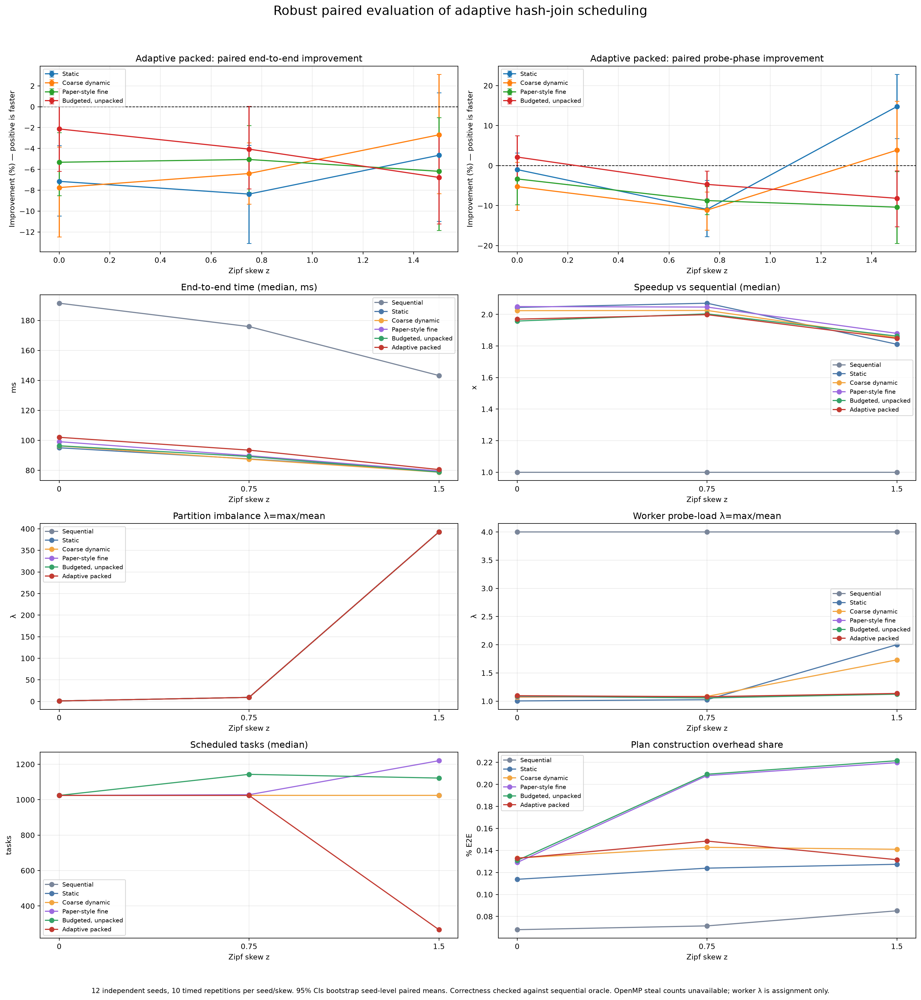
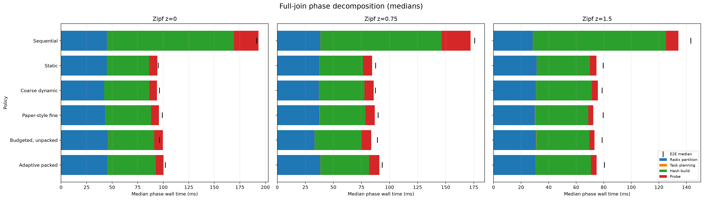

# Robust adaptive hash-join evaluation

## Design and validation

Raw measurements: `results/robust_adaptive_final.csv`. This evaluation uses 12 independent seeds (3109, 3119, 3121, 3137, 3163, 3167, 3169, 3181, 3187, 3191, 3203, 3209), 10 timed repetitions per seed/skew, 2160 rows, [4] thread(s), q=[32], coarse batch=[8], and pack threshold=[16.0]; every policy uses identical generated inputs. All 2160 rows passed the executable's independent sequential-oracle cardinality check. Worker task totals equal planned tasks on every row.

The 95% intervals resample independent seed clusters: policy-paired timed percent improvements are averaged within each seed, then seeds are bootstrap-resampled. Repetitions are not treated as independent samples. Positive improvement means `novelty_packed` is faster.

## High-skew end-to-end comparison (z=1.5)

| Baseline | Adaptive packed improvement, 95% seed-bootstrap CI |
|---|---:|
| Static | -4.65% [-10.99%, +1.34%] |
| Coarse dynamic | -2.69% [-8.34%, +3.10%] |
| Paper-style fine | -6.19% [-11.84%, -1.05%] |
| Budgeted, unpacked | -6.78% [-11.23%, -2.63%] |

## Full-join phase metrics at z=1.5

Median time by stage; E2E is measured separately and appears as a black tick in the plot.

| Policy | Partition (ms) | Planning (ms) | Build (ms) | Probe (ms) | End-to-end (ms) |
|---|---:|---:|---:|---:|---:|
| Sequential | 28.51 | 0.125 | 96.48 | 9.08 | 143.23 |
| Static | 31.40 | 0.105 | 38.36 | 4.77 | 79.62 |
| Coarse dynamic | 30.81 | 0.120 | 40.43 | 4.38 | 78.76 |
| Paper-style fine | 30.08 | 0.172 | 38.45 | 3.69 | 79.55 |
| Budgeted, unpacked | 30.88 | 0.168 | 38.47 | 3.69 | 78.82 |
| Adaptive packed | 30.54 | 0.116 | 40.08 | 4.10 | 80.52 |

Paired phase improvements for adaptive packed versus each baseline (positive means faster):

| Phase | Baseline | Improvement (95% seed-bootstrap CI) |
|---|---|---:|
| partition | Static | -5.93% [-13.82%, +1.70%] |
| partition | Coarse dynamic | -4.70% [-12.37%, +2.76%] |
| partition | Paper-style fine | -6.49% [-14.32%, +0.54%] |
| partition | Budgeted, unpacked | -7.49% [-13.46%, -1.62%] |
| build | Static | -10.60% [-17.90%, -4.12%] |
| build | Coarse dynamic | -6.28% [-12.03%, -1.04%] |
| build | Paper-style fine | -9.66% [-14.89%, -4.80%] |
| build | Budgeted, unpacked | -10.13% [-15.33%, -5.48%] |
| probe | Static | +14.76% [+6.78%, +22.78%] |
| probe | Coarse dynamic | +3.85% [-8.09%, +16.08%] |
| probe | Paper-style fine | -10.40% [-19.46%, -1.50%] |
| probe | Budgeted, unpacked | -8.18% [-15.28%, -1.28%] |

The dominant costs are partitioning and hash-table build. Reducing probe time therefore has limited leverage on total join time in this implementation. No end-to-end improvement should be claimed unless its paired interval supports it.

## Adaptive-policy diagnostics across skew

| Probe skew | Median E2E | Speedup vs sequential | Partition λ | Max / mean partition tuples | Worker probe λ | Plan time (plan/E2E) | Task count | Correct timed rows |
|---:|---:|---:|---:|---:|---:|---:|---:|---:|
| z=0 | 102.03 ms | 1.97x | 1.15 | 1127 / 976.6 | 1.10 | 0.1265 ms (0.133%) | 1024 | 120 rows |
| z=0.75 | 93.48 ms | 2.00x | 9.33 | 9114 / 976.6 | 1.08 | 0.1430 ms (0.149%) | 1024 | 120 rows |
| z=1.5 | 80.52 ms | 1.85x | 392.68 | 383480 / 976.6 | 1.14 | 0.1162 ms (0.132%) | 266 | 120 rows |

Partition λ is defined here as maximum probe tuples in any radix partition divided by the arithmetic mean over all final radix partitions (including empty partitions); equivalently, it is the max/average partition-size ratio. It is an input-skew diagnostic, not a scheduling result. Worker probe λ is the maximum worker-assigned probe tuples divided by the mean across the configured workers. Worker task/probe counts show assignment distribution, not stealing.

`planning_ms` measures task-plan construction and is included within end-to-end time. It is a narrow scheduler-planning overhead metric. `probe_ms` includes both probe work and OpenMP dynamic dispatch; these measurements cannot isolate dispatch-only overhead. Stage timings are separately measured wall times and their medians need not sum exactly to the separately measured E2E median.

Planning durations are sub-millisecond on this host; percentage comparisons at that scale are unstable and should not be interpreted as meaningful relative performance. Use their absolute median milliseconds and E2E fraction instead.

Per-worker assignment counters are updated in the probe loop; the counters are cache-line padded and each task's probe-row count is precomputed. This instrumentation is common to all policies but is not separately calibrated, so a small instrumentation perturbation remains possible. Treat timings as results from this instrumented build.

## Steal statistics and claims

Actual steal counts are **not available**. The implementation uses OpenMP `parallel for schedule(dynamic, ...)`; the OpenMP runtime does not expose a portable count of tasks stolen or re-queued to this program. Worker assignments are reported as load-balance diagnostics only and must not be labeled as steal counts.

Report as an empirical result for the stated host, workloads, and parameters. Do not claim universal improvement when a paired interval crosses zero. `paper_fine` is an approximation, not an exact reproduction of the source paper. Windows/MinGW measurements and the tested relation sizes do not replace Linux/WSL confirmation or a different-machine replication.
