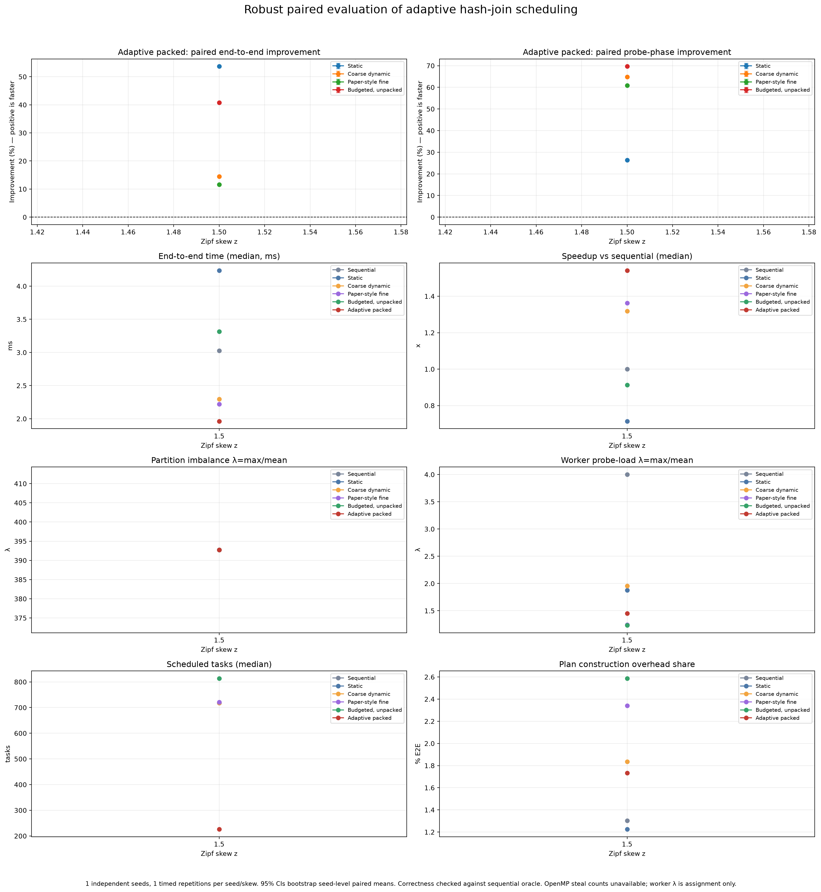

# Robust adaptive hash-join evaluation

## Design and validation

Raw measurements: `results/robust_metrics_smoke.csv`. This evaluation uses 1 independent seeds (1891), 1 timed repetitions per seed/skew, 6 rows, 1 configured thread count(s), and every policy on identical generated inputs. All 6 rows passed the executable's independent sequential-oracle cardinality check. Worker task totals equal planned tasks on every row.

The 95% intervals resample independent seed clusters: policy-paired timed percent improvements are averaged within each seed, then seeds are bootstrap-resampled. Repetitions are not treated as independent samples. Positive improvement means `novelty_packed` is faster.

## High-skew end-to-end comparison (z=1.5)

| Baseline | Adaptive packed improvement, 95% seed-bootstrap CI |
|---|---:|
| Static | +53.67% [+nan%, +nan%] |
| Coarse dynamic | +14.47% [+nan%, +nan%] |
| Paper-style fine | +11.62% [+nan%, +nan%] |
| Budgeted, unpacked | +40.78% [+nan%, +nan%] |

## Adaptive-policy diagnostics across skew

| Probe skew | Median E2E | Speedup vs sequential | Partition λ | Max / mean partition tuples | Worker probe λ | Plan time (plan/E2E) | Task count | Correct timed rows |
|---:|---:|---:|---:|---:|---:|---:|---:|---:|
| z=1.5 | 1.96 ms | 1.54x | 392.74 | 11506 / 29.3 | 1.45 | 0.0340 ms (1.732%) | 226 | 1 rows |

Partition λ is defined here as maximum probe tuples in any radix partition divided by the arithmetic mean over all final radix partitions (including empty partitions); equivalently, it is the max/average partition-size ratio. It is an input-skew diagnostic, not a scheduling result. Worker probe λ is the maximum worker-assigned probe tuples divided by the mean across the configured workers. Worker task/probe counts show assignment distribution, not stealing.

`planning_ms` measures task-plan construction and is included within end-to-end time. It is a narrow scheduler-planning overhead metric. `probe_ms` includes both probe work and OpenMP dynamic dispatch; these measurements cannot isolate dispatch-only overhead.

## Steal statistics and claims

Actual steal counts are **not available**. The implementation uses OpenMP `parallel for schedule(dynamic, ...)`; the OpenMP runtime does not expose a portable count of tasks stolen or re-queued to this program. Worker assignments are reported as load-balance diagnostics only and must not be labeled as steal counts.

Report as an empirical result for the stated host, workloads, and parameters. Do not claim universal improvement when a paired interval crosses zero. `paper_fine` is an approximation, not an exact reproduction of the source paper. Windows/MinGW measurements and the tested relation sizes do not replace Linux/WSL confirmation or a different-machine replication.
