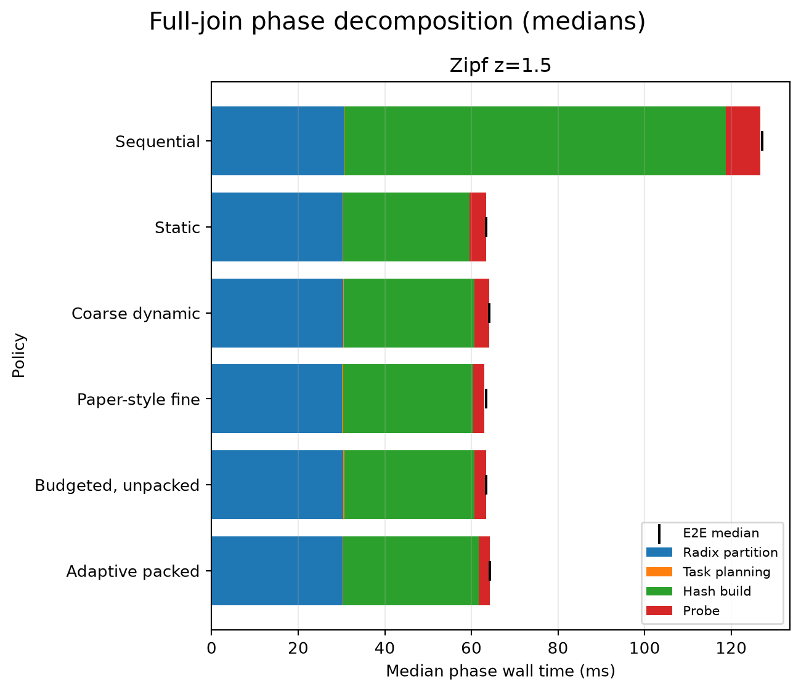
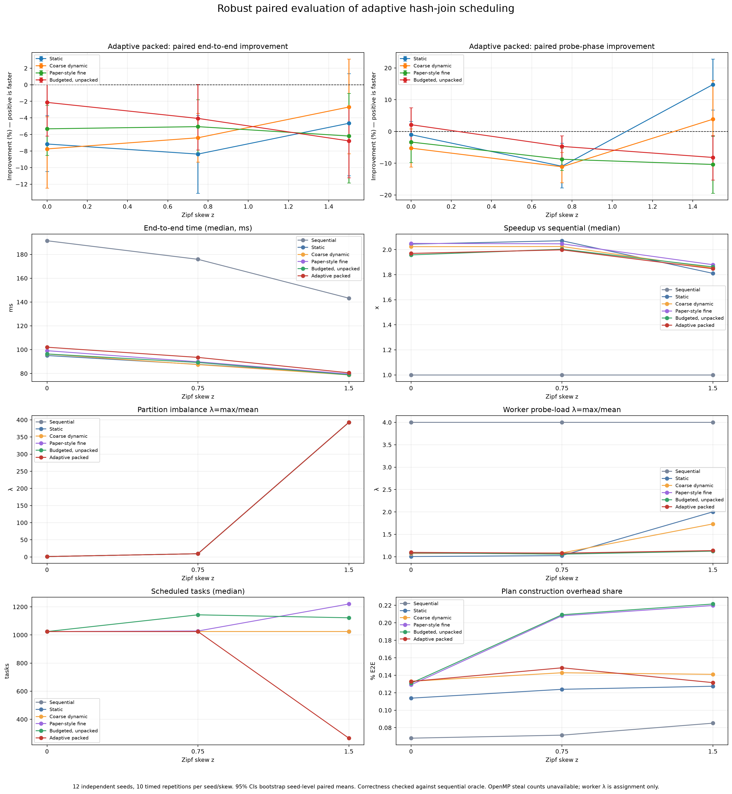
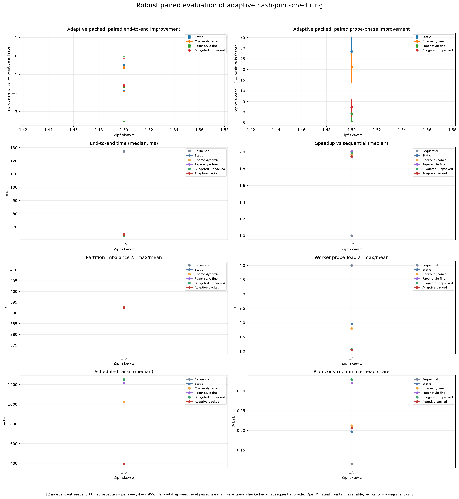

# Presentation guide: adaptive hash-join scheduling

Use this guide to present the project progress with the generated figures. The
plots are embedded below and link to the underlying image files. Full data,
method details, confidence intervals, and limitations are in
[CONSOLIDATED_REPORT.md](./CONSOLIDATED_REPORT.md).

## Suggested presentation order

### 1. Problem and implemented progress

Explain that skew can make partition-local probe work uneven. The project now
has a working C++17/OpenMP hash-join pipeline, multiple scheduling policies,
correctness checks against a sequential oracle, reproducible seeded benchmarks,
and instrumentation for end-to-end phases and worker-assigned probe load.

Introduce the proposed novelty precisely: **bounded, size-aware fine-grained
work allocation with packed partition tasks**. Do not describe it as a new
work-stealing runtime or claim that it measures steals.

### 2. Show that the evaluation covers the whole join

Show the q=64 high-skew phase breakdown:

This plot separates partitioning, planning, hash-table build, and probe timing.
The important interpretation is that probe improvements have limited leverage
on end-to-end time because partitioning and build dominate. In this confirmation,
adaptive packed's median end-to-end time was 64.31 ms: close to static (63.41 ms)
and coarse dynamic (64.13 ms), but slower than paper-style fine and
budgeted-unpacked (both about 63.45 ms).

### 3. Show the workload-dependent metric comparison

Show the all-metric q=32 summary next:

Use it to discuss runtime, speedup/efficiency, skew and partition imbalance,
worker probe-load balance, task counts, planning overhead, and correctness over
uniform, moderate-skew, and high-skew inputs. At high skew (`z=1.5`), adaptive
packed scheduled a median 266 tasks versus 1,024 for static/dynamic and had a
worker probe-load ratio of 1.14 versus 2.00 for static and 1.58 for coarse
dynamic. These are scheduling/task-balance results, **not** proof of a faster
full join.

For a direct q=64 high-skew comparison, use:

### 4. Present the strongest supported performance result

The defensible positive result is specific to the **probe phase** in the fresh
q=64 high-skew confirmation: adaptive packed was faster than static by 28.39%
(seed-level paired 95% bootstrap CI: 21.54% to 35.09%) and faster than
coarse dynamic by 21.21% (13.51% to 28.17%). It was not clearly faster than
the two fine-grained comparators in probe time.

Then immediately show the full-join comparison from the phase plot and state
that this probe gain did **not** produce a demonstrated end-to-end improvement.
The paired end-to-end intervals versus static and coarse dynamic include zero;
adaptive packed was slower than the fine-grained comparators in this
confirmation. This qualification is central to an accurate result.

### 5. Close with correctness and limitations

Report that all 720 q=64 and 2,160 q=32 confirmation rows were marked correct;
the project correctness tests check join output against an independent
sequential oracle. The partition imbalance ratio at `z=1.5` was approximately
392.4, with a maximum partition of about 383,000 tuples versus an average of
976.6.

Be explicit about limitations:

- A portable OpenMP steal counter is unavailable here. Worker assignment
  statistics are **not** steal statistics.
- Probe time includes OpenMP dispatch; dispatch-only time is not isolated.
- The `paper_fine` policy is an approximation, not an exact reproduction claim.
- These results come from Windows/MinGW on one CPU; Linux/WSL, sanitizer, and
  five-million-tuple confirmation runs are unverified.

## Claim wording

### Recommended

> We implemented and correctness-checked a bounded, size-aware packed
> scheduling policy for skewed hash-join partitions. In a 12-seed, 10-repeat
> high-skew confirmation, it reduced median probe time versus static and
> coarse-dynamic scheduling and substantially reduced scheduled task count and
> assigned probe-load imbalance. The probe-phase gains did not establish a
> full-join speedup: end-to-end performance remained comparable to static and
> dynamic scheduling and was slower than the fine-grained comparators in the
> confirmation runs.

Short version for a slide:

> **Measured progress:** better high-skew probe scheduling and fewer tasks;
> **not yet demonstrated:** faster end-to-end joins.

### Do not claim

- “Our method is faster overall” or “beats all baselines.”
- “The novelty improves performance for every skew level.”
- “We measured work-steal counts.”
- “We exactly reproduced the paper's fine-grained algorithm.”
- Any hardware-independent, Linux-validated, or five-million-tuple result.

## Figure/data index

| Use | Figure or artifact |
|---|---|
| Main full-join phase comparison | [q=64 phase breakdown](./01_final_q64_confirmation/analysis/full_join_phase_breakdown.png) |
| Main metric comparison over skew levels | [q=32 all-metric summary](./02_broad_q32_confirmation/analysis/robust_evaluation_metrics.png) |
| High-skew metric summary | [q=64 all-metric summary](./01_final_q64_confirmation/analysis/robust_evaluation_metrics.png) |
| q=64 raw confirmation measurements | [robust_q64_confirmation.csv](./01_final_q64_confirmation/robust_q64_confirmation.csv) |
| q=32 raw confirmation measurements | [robust_adaptive_final.csv](./02_broad_q32_confirmation/robust_adaptive_final.csv) |
| Full numerical interpretation and paired intervals | [CONSOLIDATED_REPORT.md](./CONSOLIDATED_REPORT.md) |

Older and tuning figures remain archived in
[03_reproduction_and_earlier_adaptive](./03_reproduction_and_earlier_adaptive/)
and [04_exploratory_tuning](./04_exploratory_tuning/). They are useful for
development history, but should not be substituted for or pooled with the
confirmation figures above.
